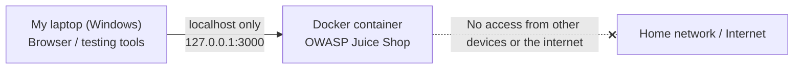

# Security Lab: Legal Scope and Isolated Lab

An isolated practice lab for security testing, built with OWASP Juice Shop running locally in Docker.

## Contents
- `rules-of-engagement.md`: my signed personal rules of engagement
- `screenshots/juice-shop-running.png`: Juice Shop open at 127.0.0.1:3000
- `screenshots/docker-ps.png`: `docker ps` output showing the container and its localhost-only port binding

## Lab Diagram

## Setup Summary
1. Installed Docker Desktop with the WSL 2 backend.
2. Started the target: `docker run -d --name juice-shop -p 127.0.0.1:3000:3000 bkimminich/juice-shop`
3. Confirmed the app loads at http://127.0.0.1:3000.
4. Isolation: the port is bound to 127.0.0.1, so only this laptop can reach it.
5. Defined the target, allowed techniques, exclusions and stop conditions in `rules-of-engagement.md`.
